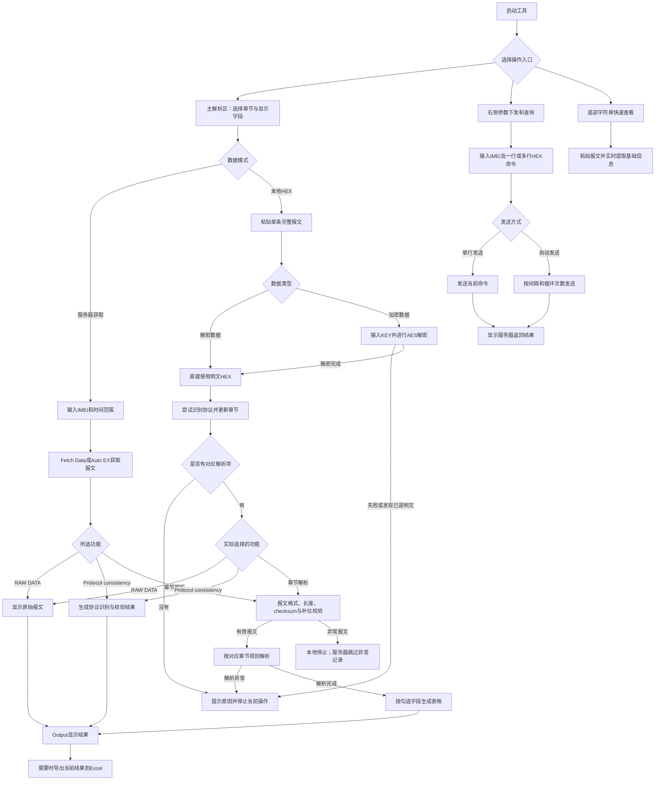

# 4.0协议服务器数据批量解析工具说明

适用版本：`4.0协议服务器获取数据批量解析-20261015.py` 及其对应程序。  
更新日期：2026-10-15。

## 工具用途

本工具用于获取和解析4.0协议报文，支持服务器批量查询、本地HEX验证、协议一致性检查，以及独立的参数下发和查询。

服务器模式适合排查设备在某段时间内的上报数据；本地HEX模式适合拿单条报文验证字段、定位解析问题。两种模式复用已有的章节解析规则。

## 第一次使用，从哪里开始

根据手里的资料，选择对应入口：

| 你现在有什么、想做什么 | 建议使用的功能 |
| --- | --- |
| 有设备IMEI，想看设备在某个时间段上报了什么 | 服务器获取 |
| 手里有一条完整的明文HEX，想知道每个字段是什么 | 本地HEX → 解密数据 |
| 手里有加密HEX和对应KEY | 本地HEX → 加密数据 |
| 只有一个协议码，不知道属于哪一章节 | 在Code框输入协议码定位 |
| 想检查服务器报文的长度、校验位、补位是否正常 | RAW DATA & Protocol → Protocol consistency |
| 想向设备查询参数或下发设置 | 右侧参数下发 / 查询工具 |
| 只想快速看IMEI、消息类型和Publish协议码 | 右侧底部ASCII/Frame解析 |

第一次可以先使用本文“本地明文练习”中的样例，不需要连接服务器，也不需要真实设备在线。熟悉输出后，再查询自己的设备数据。

### 常用词解释

| 名称 | 在本工具中的含义 |
| --- | --- |
| IMEI | 设备标识，用于确定查询或发送命令的目标设备 |
| HEX | 十六进制文本，例如 `55 55 00 2A`；每两个十六进制字符表示一个字节 |
| 完整报文 | 包含报文头、正文、校验内容、补位和帧尾的一整条消息；当前协议通常以 `5555` 开始、以 `AAAA` 结束 |
| 明文 / 解密数据 | 已经可以按照协议读取各个字段的数据；即使它看起来仍然是HEX，也可以是明文 |
| 加密数据 | 部分内容经过加密，必须先使用对应KEY解密才能正确读出字段 |
| KEY | 加密报文对应的解密密钥；需要从设备或测试资料中获取，工具不能自行推算 |
| Frame Type | 消息帧类型，用于区分连接、上报、应答等消息 |
| Code / 协议码 | 由主类型MAJOR和子类型MINOR组成，例如 `040C` 对应Device Info |
| 章节 | 协议文档中的功能编号，例如6.7；章节编号与协议码不是同一种编号 |
| Output | 解析结果、校验结果或详细错误信息的显示区域 |
| KLV / TLV | 由标签Key、长度Length和内容Value组成的数据项；多个数据项可以放在同一条报文里 |

例如 `6.7` 是Device Info在文档中的章节编号，`040C` 是它的协议码；Code框应输入 `040C`，不能输入 `6.7` 来替代。

### 界面各区域怎么用

| 界面区域或按钮 | 用途 | 什么时候使用 |
| --- | --- | --- |
| IMEI Number(s) | 输入要查询的设备IMEI | 服务器获取时填写 |
| Start Time / Stop Time | 设置查询的开始、结束时间 | 服务器获取时填写 |
| Real Time | 将结束时间改为当前时间 | 想查询到现在时点击；它本身不会获取数据 |
| Fetch Data | 根据IMEI、时间和所选章节获取并处理数据 | 手动查询服务器时点击 |
| Auto EX | 定时更新结束时间并重复获取数据 | 持续观察设备上报时使用 |
| 模式 | 在服务器获取和本地HEX之间切换 | 决定数据来自服务器还是粘贴输入 |
| Select Data Type | 选择一级数据大类 | 如车辆数据、设备状态、协议检查 |
| Select Subtype | 选择大类中的具体章节 | 如6.7 Device Info |
| Code | 显示协议码，也可以输入协议码反向定位章节 | 不知道章节、只知道协议码时使用 |
| 显示字段 | 选择结果中需要出现的列 | 获取或解析前勾选 |
| 本地HEX输入 | 粘贴完整报文，选择明文或加密数据 | 切换到本地HEX后出现 |
| 解析本地HEX | 对输入的单条报文执行解析 | 本地模式下点击 |
| 导出为 Excel | 保存当前保留的表格结果 | 得到需要的结果后使用 |
| Clear Output | 清空当前Output和结果提示 | 准备查看下一组数据时使用 |
| 协议下发查询工具 | 展开或收起右侧命令工具 | 需要发送查询或设置命令时打开 |

`Clear Output` 不会清空已填写的IMEI、时间或HEX输入，也不会代替停止自动运行；停止自动任务要使用对应的停止按钮。

## 一、服务器数据查询

### 查询前准备

准备目标设备的IMEI、大致上报时间，以及要查看的协议章节。电脑需要能够访问工具配置的服务器网络；本地HEX解析不依赖这项网络条件。

服务器获取不会自动让设备补报数据。设备没有上报、上报时间不在查询区间、或选择的章节不匹配，都可能导致结果为0。

### 手动查询步骤

1. 将模式选择为 `服务器获取`。
2. 输入设备IMEI，多个IMEI使用英文逗号分隔。
3. 输入 `Start time` 和 `Stop time`。
4. 选择一级数据类型和二级协议章节，勾选需要显示的字段。
5. 点击 `Fetch Data`，在Output区域查看结果。

服务器接口按每批1000条请求，符合继续获取条件时会请求下一批。每批1000条是请求批量，不是整个查询的固定上限；实际返回数量取决于接口响应。

### 案例：查询设备信息

假设你要查看某台设备今天上午上报的硬件、固件和版本信息：

1. 在IMEI框中填写真实设备IMEI，例如 `865869083936460`，示例编号需要替换成自己的查询目标。
2. 将开始时间填写为 `2026-10-15 09:00:00`，结束时间填写为 `2026-10-15 10:00:00`，实际使用时换成设备有上报的时间段。
3. 在Code框输入 `040C` 并按回车，确认菜单已经定位到 `6.7 - Device info`。
4. 在显示字段中勾选要查看的版本、MAC等字段；想核对报文时再勾选 `原始数据`。
5. 点击 `Fetch Data`，等待结果。
6. 检查数量提示和Output。若找到记录，每行对应一条符合当前章节条件的解析记录，各列对应已勾选字段。

如果结果为0，先检查设备是否在该时间范围上报过Device Info。查到其他类型报文，不代表一定存在Device Info报文。

多个IMEI的输入格式如下，使用英文逗号，不要使用中文顿号：

```text
865869083936460,865869083845802
```

同一时间范围会应用到这些设备。查看结果时保留IMEI列，便于区分数据归属。

### 时间输入

开始时间和结束时间支持以下格式，粘贴时会去除左右空格：

| 输入类型 | 格式或说明 |
| --- | --- |
| 北京时间 | `2026-09-07 18:40:18` |
| UNIX秒时间戳 | 10位数字 |
| UNIX毫秒时间戳 | 13位数字 |

UNIX时间戳按UTC时间转换为北京时间，即UTC+8。输入完成后，界面统一显示为 `yyyy-MM-dd HH:mm:ss`。

例如以下两种UNIX输入，界面都显示为 `2026-09-08 08:48:15`：

```text
1788828495
1788828495748
```

第一种精确到秒，第二种携带毫秒；当前界面显示精度到秒。输入UNIX时间戳后，点击其他控件结束编辑，即可看到转换后的时间。

注意左右空格可以自动去除，日期内部格式仍需要正确。例如可以粘贴前后带空格的 `2026-09-07 18:40:18`，但不要把日期分隔符改为 `/`，也不要把日期与时间之间改成多个空格。开始时间应早于结束时间；初次查询建议先选一个较小的时间范围。

`Real Time` 用于将结束时间更新为当前时间。

### 自动获取

`Auto EX` 按5秒定时间隔更新结束时间并重新获取数据，开始时间保持不变。网络请求和解析耗时可能使实际刷新间隔变长。

可以使用 `Stop Auto EX` 手动停止；运行满3600秒后，工具自动停止并提示。此规则属于主界面的自动获取，与右侧命令自动发送分别控制。

例如开始时间固定为09:00，运行到09:10时查询的是09:00至09:10，运行到09:20时查询的是09:00至09:20。它不是每次只查询新增加的5秒数据，因此运行越久，查询区间可能越大。

准备改用本地HEX前，先停止主界面的Auto EX，避免自动获取继续刷新当前输出。

## 二、本地HEX解析

切换为 `本地HEX` 后，使用本地输入框和 `解析本地HEX` 按钮进行验证，无需从服务器获取报文。输入框保持固定单行高度。

当前按单条完整报文使用，不要将多条报文直接拼接后作为一条输入。

切换后，服务器用的IMEI、开始时间、结束时间和Fetch Data会变为不可编辑或不可点击。这是正常状态：本地模式从报文中读取IMEI，使用报文携带的时间字段，不使用服务器查询时间来筛选这条报文。

### 解密数据：直接解析

`数据` 默认选择 `解密数据`，这里指已经解密、可以直接按协议读取的明文HEX。

1. 粘贴一条完整HEX报文，允许带空格、换行，字母大小写均可。
2. 点击 `解析本地HEX`。
3. 工具尝试自动定位协议章节，完成校验后调用对应解析规则。
4. 在Output查看结果；需要查看报文时，勾选对应章节的 `原始数据` 后重新解析。

输入框中只放HEX内容，不要包含 `raw_data =`、引号、日志时间、`0x`前缀或说明文字。完整报文很长、在单行输入框中横向滚动是正常现象，输入框没有要求把全部内容同时显示出来。

### 本地明文练习：解析一条参数设置响应

下面是一条可以直接用于本地练习的完整明文报文：

```text
5555002A400102001E38363538363930383339333634363004000E0005F1020233014E9404EDFFFFAAAA
```

操作步骤：

1. 将模式切换为 `本地HEX`。
2. 将数据类型保持为默认的 `解密数据`，不需要输入KEY。
3. 把上面的完整HEX粘贴到本地输入框。
4. 点击 `解析本地HEX`。
5. 检查菜单是否跳转到 `8.2 - Set parameters`。
6. 保留IMEI和设置结果字段，查看Output。

这条样例的关键信息为：

| 项目 | 预期内容 |
| --- | --- |
| IMEI | `865869083936460` |
| 帧类型 | `04`，即Puback应答 |
| 协议码 | `F102` |
| 对应章节 | 8.2 参数设置响应 |
| 参数结果 | 参数 `0233` 返回 `successful` |

这是对一条现有设备响应的离线解析练习。点击本地解析不会向样例IMEI发送设置命令。

### 加密数据：先解密再解析

将 `数据` 切换为 `加密数据`，界面会显示KEY输入框。

1. 输入该报文对应的KEY：64个十六进制字符，即32字节AES-256密钥。
2. 粘贴加密HEX报文。
3. 点击 `解析本地HEX`，工具按AES-256 ECB解密，再进行协议校验和章节解析。

此功能适用于当前后装协议的加密格式：前24字节报文头和末尾2字节帧尾保留，中间密文按16字节块解密。不能将任意其他加密格式直接套用。

如果输入已经通过完整明文协议校验，工具会提示切换为 `解密数据`，避免重复解密。KEY格式、密文长度或解密后报文异常时，状态栏给出简短提示，详细原因显示在Output。

加密模式下，章节结果中的 `原始数据` 是解密后实际参与解析的HEX，输入框中的密文不会被自动替换。

### 本地加密练习：解密后得到同一条响应

下面的KEY和加密HEX是一组配套测试样例，KEY仅用于这条样例，不是其他设备的通用密钥。

KEY输入框填写：

```text
ECFC69A548ADA26877661AF3AA89CBEBCFD8973CA572B7A1ED16E9F36C807DBD
```

本地HEX输入框填写：

```text
5555002A400102001E383635383639303833393336343630BDC52015087AF8B694D18FE8CD03543BAAAA
```

将数据类型切换为 `加密数据`，分别填好两个输入框，再点击 `解析本地HEX`。成功时会得到与上一节明文样例相同的协议和参数结果。

如果要看到解密后的完整HEX，进入8.2的显示字段勾选 `原始数据`，然后重新点击解析。该列应与上一节的明文报文一致。

### 自动识别协议

本地解析会结合Frame Type与DATA_TYPE_MAJOR、DATA_TYPE_MINOR识别已支持的协议，并更新菜单、Code和字段复选框。例如Connect帧按帧类型识别，Publish和Puback帧结合协议码定位。

已识别的报文会自动切换章节，可能覆盖当前手动选择；无法自动定位时，仍需手动选择已有解析项。自动识别不代表所有帧类型和所有协议都已有解析规则。

因此，第一次点击后可以先确认自动选择的章节和显示字段，再调整勾选项并重新解析。本地自动识别优先处理已支持的Connect、Disconnect，以及Publish、Puback中已映射的协议码。

当前没有“关闭自动识别”的独立开关。对于能被自动识别的本地报文，即使预先选择了Protocol consistency，也可能被切回具体章节；不要把预选菜单当作强制锁定。

## 三、协议选择与Code定位

可通过两级菜单选择数据大类和具体章节。选择章节后，Code框显示对应协议码。

如果只有协议码，可以直接在Code框输入，短暂停顿或按回车后定位对应章节：

| 输入示例 | 对应章节 |
| --- | --- |
| `0100` 或 `01 00` | 2.1 急加速 |
| `040C` 或 `04 0C` | 6.7 Device Info |
| `F103` 或 `F1 03` | 8.3 参数查询响应 |

Code由DATA_TYPE_MAJOR和DATA_TYPE_MINOR组成，不是Frame Type。输入Code只切换章节，不会自动请求服务器或执行本地解析；未匹配时会显示提示。

### 手动选择和自动识别的区别

| 操作 | 作用 | 是否马上解析 |
| --- | --- | --- |
| 手动切换两个下拉菜单 | 指定想查看的章节，并更新显示字段 | 否 |
| 在Code框输入 `040C` | 找到6.7章节，与手动选择菜单作用相同 | 否 |
| 服务器模式点击Fetch Data | 获取数据，并按当前选择的功能处理 | 是 |
| 本地模式点击解析本地HEX | 尝试识别输入报文，校验后调用对应章节 | 是 |

服务器模式适合“我想找这个章节的数据”；本地模式适合“我有这条报文，想知道它是什么”。选择了某个章节，并不会把不属于该章节的报文转换成该章节的数据。

### 当前章节范围

下表按当前菜单和已绑定解析项归类，具体字段以相应章节的显示字段为准。

| 分类 | 当前范围 |
| --- | --- |
| 原始数据与协议检查 | RAW DATA、Protocol consistency |
| 第0章 | Connect、Disconnect |
| 第1章 行程数据 | 1.1至1.5 |
| 第2章 驾驶行为 | 2.1至2.24 |
| 第3章 定位数据 | 3.1 GPS、3.2 LBS |
| 第4章 车辆数据 | 4.1至4.6，包含Data flow、配置动态数据流和车辆KLV信息 |
| 第5章 安全数据 | 5.1至5.15，包含设备告警、DTC和J1939 DTC等 |
| 第6章 设备状态 | 6.1至6.30及Bosch碰撞相关项；6.18至6.21仅保留入口 |
| 第7章 设备主动请求 | 7.1至7.4；7.5、7.6仅保留入口 |
| 第8章 服务器主动请求及响应 | 菜单覆盖8.1至8.15；围栏项提供8.11.2、8.12.2响应解析 |
| 第9章 附件数据 | 9.1至9.7 |
| 第10章 Tachograph | 10.1 数据透传 |

带 `-暂不开发` 的Router相关项只用于保留菜单和Code定位，尚未实现业务解析。

## 四、字段展示与Excel导出

### 显示字段

各章节提供对应的字段复选框。根据需要勾选IMEI、时间、速度、电压、版本、状态等字段，再执行获取或解析。

结果通过表格展示，表头和字段在对应列左对齐，数据行交替使用白色和浅蓝色。宽报文可通过横向滚动查看；单元格悬浮提示目前已屏蔽。

`原始数据` 通常默认不勾选。勾选后会增加独立列，展示对应记录的HEX报文。`Protocol consistency` 也提供默认不勾选的原始数据字段。

### 如何调整结果中的列

例如只想查看Device Info的IMEI、版本号和原始数据：

1. 先选择6.7 Device Info，确认“显示字段”已经切换为这一章节的字段。
2. 勾选需要的项目，取消暂时不看的项目。
3. 重新点击Fetch Data或解析本地HEX。
4. 在Output检查新的列标题。

勾选是控制下一次结果生成时显示什么，不要假设勾选后旧结果会立即重新解析。不同章节的字段集合不同，切换章节后也要重新确认勾选状态。

服务器查询模式下，字段复选框控制输出列，不负责改变服务器上的设备配置。把“原始数据”取消勾选，也不会删除服务器报文。

### 表格中的一行、一列分别代表什么

通常一条符合章节条件的消息对应一行记录，列名说明这一列是什么字段。带TLV的消息可能在同一个单元格内包含多行Key内容，这些换行仍属于同一条消息。

例如一条报文携带5个WiFi，LBS单元格可能出现5行WiFi明细。这不表示收到了5条独立报文。需要确定消息边界时，同时查看IMEI、时间和原始数据列。

原始数据较长时可以拖动底部横向滚动条查看。检查“标题是否与数据对齐”时，应比较同一列的起点，而不是比较不同长度文本的末尾。

4.2 Data flow的显示字段和输出标题使用完整字段名称，取消原先用于节省空间的A到Z缩写。

### KLV / TLV内容

相关章节将每个Key单独放在一行，采用类似以下的显示方式：

```text
1001 - 发动机转速 - 数值
1002 - 车辆速度 - 数值
```

已匹配的Key编号使用蓝色加粗显示，并统一分隔空格。Key 411的LBS数据按基站数量、各基站、WiFi数量、各WiFi分别换行，便于逐项查看。

有定义的Key按对应规则转换；未定义的Key保留原始HEX供核对。动态长度用于确定当前Value和下一个TLV的边界，并不表示任意长度都能按已知字段定义解释。例如Key 408超过已知16字节定义的部分，会作为未定义扩展数据保留。

阅读TLV时，可以把一行理解为“哪个参数、参数叫什么、这次的值是多少”。例如 `401 - 经度 - ...` 表示Key 401的内容按经度定义显示。蓝色加粗的是Key编号，便于在大量数据中定位。

协议资料可能用十六进制编号，界面使用十进制编号。例如 `0x019B` 等于十进制 `411`，二者指向同一个LBS标签，不是两个不同字段。

### 参数响应与版本字段

- 8.3参数查询响应按已支持的参数定义显示精度、偏移、单位和枚举含义；长度为0的参数显示 `Length zero`。
- 相关附件参数按支持情况显示具体附件名称，均不支持时显示 `No accessories`。
- Connect和Device Info中的变长字段按报文携带的长度读取；对已兼容的可选字段，缺失时显示 `报文未携带` 等提示。

常见特殊显示可以这样理解：

| 显示内容 | 含义 |
| --- | --- |
| 报文未携带 | 这条报文没有提供对应的可选字段，不等于解析出了一个空字符串 |
| Length zero | 识别到了参数编号，但该参数携带的数据长度为0，不能按正常数值解释 |
| No accessories | 对应附件参数表示没有支持的附件 |
| 00-disable等“原值-含义”格式 | 保留原始枚举值，并附带已匹配的状态说明 |
| FF / FFFF | 某些字段的特殊值；具体代表无效、未提供还是其他状态，需要结合该字段定义 |
| 未定义扩展数据 | 报文中有额外内容，但当前已知字段定义不足以解释，保留HEX供核对 |

### 导出Excel

解析完成后点击导出按钮，选择 `.xlsx` 保存位置。表格结果按“标题一列、对应数据位于该列下方”的方式导出；单元格内的TLV换行会保留为Excel单元格内换行，界面蓝色加粗样式不随数据导出。

导出基于当前输出所保留的结果，不会重新请求服务器。部分旧格式结果导出时，如果某行列数不匹配，会跳过并提示数量。RAW DATA纯报文查看主要用于核对原文，不应当作带字段标题的解析表导出。

建议按以下顺序导出：

1. 先选好显示字段，重新执行获取或解析。
2. 在Output检查标题、数据、记录数量是否符合需要。
3. 点击 `导出为 Excel`，选择保存目录并填写文件名。
4. 保存成功后，工具会打开所在文件夹，便于找到文件。
5. 打开Excel检查列名及数据；想保留原始HEX时，要在解析前先勾选“原始数据”。

若提示保存失败，检查目标目录是否可写，以及同名Excel文件是否正被其他程序占用。清空Output后再导出，不会自动恢复上一批结果。

### 显示数量与查询总量

- `RAW DATA` 当前只显示前1000条报文，数量标签统计获取总量。
- `Protocol consistency` 先检查输入数据，再截取前1000行结果用于显示；这1000行包含表头，因此最多显示999条数据记录。
- 一致性检查的Excel导出基于这部分已显示结果，不代表全部查询数据。
- 其他章节没有统一的1000行显示上限，大批量HTML表格仍可能有渲染等待；当前没有结果翻页界面。

例如服务器返回2000条数据，RAW DATA仍只显示前1000条。Protocol consistency还会占用一行表头，因此最多显示999条检查记录。数量提示可能大于肉眼看到的行数，这两者统计对象不同。

某一章节的“找到多少个事件”通常统计匹配到该章节的记录，也不等于服务器返回的全部消息数。

## 五、协议一致性检查与异常提示

选择 `RAW DATA & Protocol -> Protocol consistency`，用于查看报文结构和校验结果，主要包括：

- 声明消息长度与实际长度。
- 协议版本、加密方式、电池电量。
- 帧类型、帧序号、有效数据长度。
- 协议码对应的数据类型。
- Adler32 checksum校验。
- FF补位校验。

### 检查步骤与结果解读

1. 选择 `服务器获取`，填写IMEI和时间范围。
2. 一级菜单选择 `RAW DATA & Protocol`。
3. 二级菜单选择 `Protocol consistency`。
4. 需要核对原文时勾选 `原始数据`。
5. 点击 `Fetch Data`，逐列查看结果。

| 检查列 | 它在比较什么 | 看到异常时先检查什么 |
| --- | --- | --- |
| 长度校验 | 报文声明的总字节数是否等于实际字节数 | 是否少复制、重复拼接，或在末尾多了字节 |
| checksum校验 | 报文携带的Adler32是否与重新计算的一致 | 内容是否被修改、数据是否截断、是否仍是密文 |
| FF补位校验 | 有效数据与checksum后面的补位是否符合对齐规则 | FF数量、有效数据长度、checksum边界 |
| 数据类型 | 已识别的帧类型或协议码名称 | 是否选错协议，当前工具是否已有该协议名称映射 |

`PASS` 表示这一项通过；`FAIL`或界面中的 `FAILFAIL(...)` 表示未通过。括号内可能是重新计算得到的长度、checksum或补位内容，应结合所在列判断，不能把它们都当作同一种错误。

“有效长度”指协议正文中声明的有效数据长度，不等于整条消息长度；报文还包括头部、校验和补位等内容。HEX字符数也不是字节数，例如 `FFFF` 是4个字符、2个字节。

普通章节解析前，会检查HEX格式、帧头帧尾、报文长度、有效数据边界、checksum和FF补位。协议一致性检查本身用于展示异常，不与普通章节采用完全相同的拦截方式。

本地数据校验不通过时停止当前解析并说明原因；服务器批量解析会跳过前置校验失败的数据。进入章节解析后，如果发生已捕获的解析异常，会停止当前章节处理并在Output显示错误，供后续修正代码和协议规则。

这些防护用于降低异常报文导致程序退出的风险，不代表报文通过校验后，全部字段含义就一定正确。遇到未知字段或协议变更，仍需结合原始HEX与协议文档核对。

前置校验和解析容错分别处理不同阶段：前者拦截结构明显异常的数据，后者接住具体章节处理时发生的错误。遇到错误提示时，优先记录模式、章节、完整HEX和Output中的错误内容，便于复现。

## 六、右侧参数下发 / 查询工具

右侧工具是独立入口，不依赖主解析区所选的章节。

点击窗口右侧的 `协议下发查询工具` 展开面板。这里有自己的IMEI输入框，不会因为主界面已经填了IMEI就自动使用那个目标。

### 单条命令怎么发送

1. 输入目标IMEI，多个IMEI使用英文逗号分隔。
2. 输入合法HEX命令，常用 `F102` 表示参数设置，`F103` 表示参数查询。
3. 核对这一行的类型显示、目标IMEI及命令内容。
4. 点击这一行的 `发送`，查看主界面结果提示中的服务器返回信息。

### 案例：查询和设置急减速阈值

以 `Threshold of rapid deceleration`（急减速阈值）为例，该参数的编号为 `0002`。

查询与设置使用的参数标识长度不同：查询时每个参数编号占 **2字节**，其中低12位有效；设置时使用 **4字节** 的参数标识。本例查询使用 `0002`，设置使用 `00020000`，后面再跟参数值。

| 操作 | 命令框填写内容 | 含义 |
| --- | --- | --- |
| 查询当前值 | `F1030002` | 查询参数 `0002` 当前的值 |
| 同时查询两个阈值 | `F10300010002` | 按顺序查询急加速阈值 `0001` 和急减速阈值 `0002` |
| 设置参数 | `F1020002000028` | 将参数 `0002` 的原始数值设置为十进制 `40` |

查询参数列表的格式为“参数编号 + 参数编号 + ……”；列表中的每个编号都是2字节，不包含时间字段。例如 `00010002` 应拆成 `0001 | 0002`，表示两个参数。

**先查询当前值：**

1. 展开右侧工具，在右侧IMEI框填写目标设备IMEI。
2. 在命令框输入 `F1030002`，其中 `F103` 表示查询，`0002` 表示急减速阈值参数。
3. 点击这一行的 `发送`，查看服务器返回提示。
4. 等待设备响应后，在主解析区选择 `服务器获取`，填写同一设备IMEI和覆盖响应时间的查询区间。
5. 选择 `8.3 - Inquiry parameters`，点击 `Fetch Data`，查看参数 `0002` 的返回值。

**再设置为40：**

1. 将右侧命令框内容改为 `F1020002000028`。
2. 这条命令应拆分为 `F102 | 00020000 | 28`：`F102` 是设置命令，`00020000` 是设置时使用的4字节参数标识，`28` 是本参数的1字节原始值；十六进制 `0x28` 换算成十进制就是 `40`。
3. 核对目标IMEI和命令后，点击这一行的 `发送`。
4. 在主解析区查询 `8.2 - Set parameters` 的响应，确认设备是否设置成功。
5. 再发送一次 `F1030002`，然后在8.3章节查看查询响应，核对设置后的值。

这里的 `40` 指命令中的原始数值。当前8.3展示规则对参数 `0002` 使用精度 `10`、单位 `mg`，因此设备若返回原始值 `0x28`，解析结果会显示为 `400 mg`。填写命令时要区分原始数值与换算后的带单位数值。

上述命令可以直接填入命令框，不需要添加引号或本文用于说明结构的竖线。其他参数的设置内容需要根据各自定义填写，不能只替换编号就沿用本例的数据格式。

命令框通常填写服务器接口所需的命令内容，不需要把本地解析用的 `5555...AAAA` 完整帧照搬进来。工具会显示命令类型，但类型识别不等于已经验证全部参数含义。

当前命令输入检查主要确认非空、HEX字符合法和长度为偶数；发送范围并未在代码中强制限定为F102/F103。其他命令是否可执行取决于服务器和设备支持情况。

点击某一行的 `发送`，只处理该行命令，并对右侧填写的目标IMEI逐个请求。主解析区处于本地模式，也不影响右侧命令入口仍通过服务器发送。

### 多条命令与自动发送

通过 `增加命令行` 添加输入行，最多10行。点击某行 `删除` 可以移除该行；只剩一行时会清空该行内容，并保留一个输入框。

自动发送会收集可通过当前输入检查的命令，按行顺序发送；一轮结束后，根据循环次数决定是否从第一行重新开始。无效行不会进入发送队列，因此启动前应检查每行内容。

例如右侧只有一个IMEI，有3条有效命令，每条间隔2秒，循环2次，执行顺序为：

```text
第1轮：命令1 → 命令2 → 命令3
第2轮：命令1 → 命令2 → 命令3
```

第一条立即发送，后续按定时器调度，总共执行6条命令。如果填写多个IMEI，每条命令还会分别请求这些目标，网络耗时可能影响实际间隔。

每条间隔支持1至3600秒，循环次数支持1至9999次。发送后显示服务器返回结果；服务器接收成功不等于设备已执行成功，需要结合设备响应报文确认。参数设置和查询响应可分别在8.2、8.3章节查看。

开始后按钮变为 `停止自动发送`，可随时用于停止后续自动调度。此处按循环次数结束，不使用主界面Auto EX的1小时停止规则。

### 怎样确认设备真的返回了结果

发送后的提示可能包含HTTP状态、服务器code、flowId和message。HTTP成功表示接口请求成功返回，设备是否在线、是否接受参数、具体参数值是什么，还需要看服务器业务返回和设备上报。

常用核对过程为：右侧发送F103查询 → 等待设备响应 → 左侧切换服务器获取 → 选择8.3 Inquiry parameters → 查询覆盖发送时间的区间。F102设置响应则在8.2查看。

主解析区选择8.2或8.3只是解析已有响应，不会代替右侧发送命令。

### 底部字符串快速查看

右侧底部提供无需按钮的实时提取：

| 内容 | 取值方式 |
| --- | --- |
| IMEI | 去除空白后的HEX字符串 `[18:48]` 转ASCII |
| 消息类型 | `[48:50]` 显示connect、publish等名称 |
| 协议码 | 仅当消息类型为 `03` 时，读取 `[58:62]` |

这些位置是HEX字符串字符下标。此区域用于快速查看基础信息，不执行完整协议校验或AES解密；加密报文应使用主解析区的本地HEX解密功能。

把完整明文报文粘贴进“原始报文”框后，下方“转换结果”会自动更新，无需点击发送或本地解析。消息类型为04的Puback，在这个快速查看区不会额外提取Code；要查看其具体协议和参数内容，应使用主解析区。

## 七、常见问题与排查顺序

### 1. 为什么点击Fetch Data没有解析记录

依次确认：模式是否为服务器获取、IMEI是否正确、时间是否覆盖设备上报、章节是否与目标报文匹配、电脑是否能访问配置的服务器。

可以先用RAW DATA确认是否返回原始报文，再选择具体章节。服务器有返回但某章节结果为0时，可能只是返回数据里没有该章节对应的帧类型和协议码。

### 2. 为什么本地模式下IMEI和时间框是灰色的

本地解析直接使用粘贴的报文，不需要服务器查询条件。这些控件停用是正常的，切回服务器获取后恢复。

### 3. HEX也是一串看不懂的字符，怎么知道有没有加密

HEX只是一种字节表示方式，并不等于加密。优先以数据来源说明为准：抓取的是加密原始流，还是已经解密的协议报文。

已有明文按“解密数据”解析；密文需要对应KEY。当前版本在加密模式发现输入已通过完整明文校验时，会提示切换。不能仅凭 `5555`、`AAAA` 判断中间内容是否加密。

### 4. 为什么报“长度不匹配”或“有效数据长度异常”

检查是否复制了完整的一条报文、是否在结尾多复制了一个 `AA`、是否把两条完整报文直接拼在一起，以及数据类型选项是否正确。密文误当明文或KEY不匹配，也可能让解密后的长度字段异常。

不要为了消除提示就直接修改长度字段；修改字段后，checksum等内容也会受到影响。应优先回到原始数据来源核对。

### 5. 为什么改了显示字段，旧结果还是原来的样子

重新执行Fetch Data或解析本地HEX。字段复选框用于下一次生成结果，导出也以已经生成的当前结果为准。

### 6. 原始数据列默认没有，是不是没有拿到HEX

多数章节只是默认不显示这一列。勾选“原始数据”并重新执行后查看；加密本地解析显示的是解密后的报文。

### 7. 查询几千条数据，为什么显示或导出不足几千条

先区分服务器获取总量、当前章节匹配数量、Output保留的显示行数。RAW DATA和Protocol consistency有显示截取，导出不会自动补回未保留的记录，具体限制见“显示数量与查询总量”。

### 8. 数据多时为什么会等待

等待可能发生在服务器请求、协议校验、字段解析或HTML表格排版阶段。字段多、原始HEX长、TLV明细多时，显示也需要时间。

先缩小查询时间范围、只保留需要的列，确认流程正常后再扩大范围。减少显示字段可能减轻展示负担，但不代表同比例减少网络请求或所有字段解析计算。

### 9. 提示未携带、Length zero，是不是程序坏了

这些提示描述报文中的缺失或零长度情况，通常不需要当成程序崩溃处理。是否符合设备业务预期，需要结合设备版本、报文和协议定义判断。

### 10. 遇到“解析失败，已停止当前章节”怎么办

查看Output中的具体异常，保留原始HEX、当前版本、所选模式和章节。先用单条本地HEX复现，便于区分是某条报文异常，还是某个字段的解析规则需要更新。

工具可以继续处理后续手动发起的操作；不要把当前章节已停止误解为所有数据都已成功解析。

### 11. 右侧显示发送成功，为什么8.3没有数据

确认右侧使用的是正确IMEI、设备能够响应、查询时间覆盖发送之后的响应时间，并检查服务器返回的业务信息。接口HTTP成功不能代替设备参数查询应答。

### 12. 下拉里有某一章节，为什么不能解析

带 `-暂不开发` 的条目只保留入口。其他条目也需要满足对应帧类型和协议布局；出现新版本字段时，可能仍需要补充解析规则。

## 八、运行流程图


