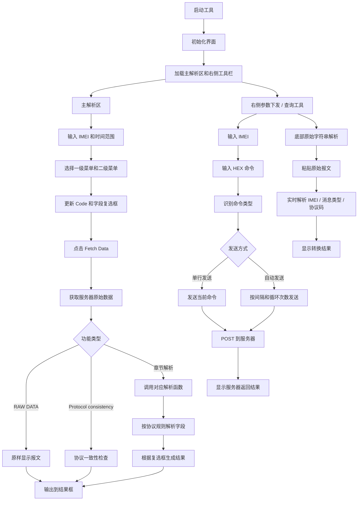

# 4.0协议服务器数据批量解析工具说明

## 工具定位

该工具用于对 4.0 协议服务器数据进行批量获取、协议识别、字段解析和结果展示。

它主要解决的问题是：原始报文内容长、协议章节多、字段位置固定但人工解析成本高。通过图形界面选择数据类型和协议章节后，工具可以自动完成数据获取、协议判断、字段切片、格式转换和结果输出。

## 主要功能

### 1. 服务器数据批量获取

用户输入 IMEI、开始时间和结束时间后，点击 `Fetch Data`，工具会从服务器接口获取对应时间范围内的原始报文数据。

支持多个 IMEI 逗号分隔输入，适合批量排查设备数据。

### 2. 协议章节选择

工具通过两级菜单选择解析类型：

- 一级菜单：选择数据大类，例如 Trip data、Vehicle data、Secure data、Device state 等。
- 二级菜单：选择具体协议章节，例如 `4.2 - Data flow`、`5.14 - DTC code (for J1939)` 等。

选择二级菜单后，右侧 Code 框会自动显示对应协议码，方便核对当前解析项。

### 3. 字段复选框展示

不同协议章节会显示不同的字段复选框。

用户可以按需勾选输出字段，例如：

- IMEI
- 触发时间
- 速度
- 电压
- DTC 信息
- 原始报文

解析结果只展示已勾选字段，便于快速查看重点数据。

### 4. RAW DATA 原始报文查看

选择 `RAW DATA & Protocol -> RAW DATA` 时，工具会直接显示服务器返回的原始报文，不做字段解析。

该功能适合用于原始数据确认、协议对照和异常报文保存。

### 5. Protocol consistency 协议一致性检查

选择 `RAW DATA & Protocol -> Protocol consistency` 时，工具会对原始报文进行基础一致性检查。

主要检查内容包括：

- 消息长度
- 协议版本
- 加密方式
- 电池电量
- 帧类型
- 帧序号
- 有效数据长度
- 协议码对应的数据类型
- checksum 校验
- FF 补位校验

该功能主要用于判断一批报文结构是否正常，以及报文协议码是否能被工具识别。

### 6. 章节字段解析

选择具体协议章节后，工具会根据当前一级菜单和二级菜单，找到对应的 `process_xxx` 解析函数。

解析函数会按协议字段位置切片，并完成必要的转换，例如：

- HEX 转十进制
- HEX 转时间
- ASCII 转字符串
- 状态码转含义
- 位状态提取
- 特殊值 `FF` / `FFFF` 保留显示

解析完成后，结果显示在主输出框中。

### 7. 右侧参数下发 / 查询工具

右侧工具栏用于直接向设备发送参数下发或查询命令。

主要功能包括：

- 输入一个或多个 IMEI。
- 输入 HEX 命令。
- 自动识别命令类型，例如 `F102` 设置、`F103` 查询。
- 支持单行发送。
- 支持增加多行命令。
- 支持删除命令行。
- 支持按固定间隔和循环次数自动发送。
- 发送后显示服务器返回结果。

该功能不依赖左侧协议解析菜单，是独立的参数下发/查询入口。

### 8. 底部原始字符串实时解析

右侧工具栏底部提供原始字符串快速解析能力。

用户粘贴原始报文后，工具会实时提取：

- `[18:48]` IMEI ASCII 内容
- `[48:50]` 消息类型
- `[58:62]` publish 报文协议码

该功能适合快速判断单条报文的基础信息。

### 9. 自动运行

工具支持自动运行逻辑，可按固定节奏刷新结束时间并重新获取数据。

该功能适合长时间观察服务器数据上报情况。

## 运行流程图

## 使用价值

该工具将原本需要人工切片、人工换算、人工比对协议文档的过程集中到一个界面中完成。

实际使用时，可以减少重复解析工作，提高问题定位效率，也方便后续持续扩展新的协议章节。
